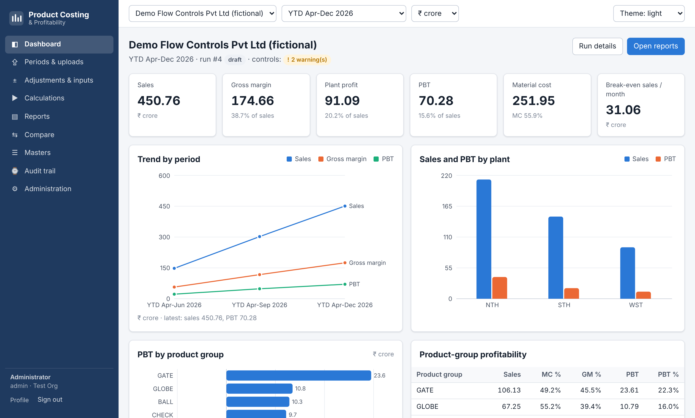
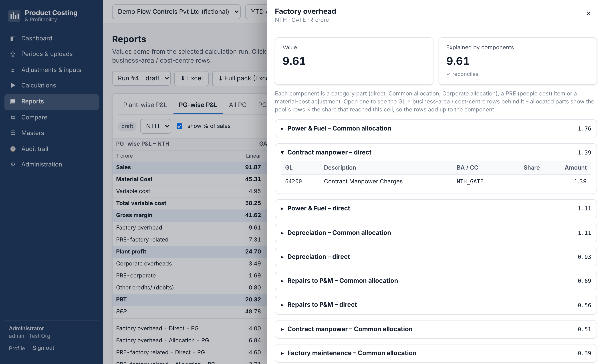

# Product Costing & Profitability

Plant-wise and product-group-wise P&L from trial balances – a web application that replaces the
*Product costing – plant wise* Excel workbook.

Upload the business-area and cost-centre trial balances, and the application tags every GL, applies
audited adjustments, allocates Common, Corporate and people-related (PRE) costs to product groups
with configurable rules, and produces the P&L reports in the familiar layout – with controls that
prove every rupee is accounted for, drill-down to GL × business area / cost centre, maker-checker
approval and a full audit trail.



## Features

* **Inputs** – Excel / CSV trial-balance upload with automatic header detection, column matching by
  name and a validation report (new GLs, business areas, cost centres, duplicates, total mismatches).
  Adjustment rules (regroup, move, exclude, correct, reclassify) with reason and author;
  material-cost adjustments; allocation drivers; MIS figures.
* **Masters** – business areas, GL accounts, cost centres, product groups and families, categories,
  PRE functions, allocation rules, P&L lines and report layouts; versioned by effective date, editable
  in the browser, Excel export / import.
* **Engine** – tagging → adjustments → aggregation → Common / Corporate / PRE allocation (Direct and
  Allocated kept separately) → P&L with % of sales, MC % and break-even → controls. A full run takes
  well under a second.
* **Reports** – plant-wise, PG-wise, PG totals, all PG, MC %, MIS check, management summary;
  period-on-period and budget-vs-actual comparison; Excel in the workbook's layout and PDF; drill-down
  from any amount to the GL rows behind it.
* **Control** – maker-checker (draft → submitted → approved → published), period lock, audit trail of
  every change, roles (admin, costing analyst, approver, viewer), password or single sign-on (OIDC).
* **Platform** – multi-company and multi-organisation, Indian or international number format,
  ₹ / thousand / lakh / million / crore, company backup / restore, Docker for on-premises or cloud.
* **Legacy import** – builds a company's complete configuration from the existing workbook and proves
  the result matches the workbook to the rupee.



## Quick start (Docker)

```bash
cp .env.example .env          # set POSTGRES_PASSWORD, PC_SECRET_KEY and PC_BOOTSTRAP_ADMIN_PASSWORD
docker compose up -d --build
```

Open <http://localhost:8080> and sign in with `PC_BOOTSTRAP_ADMIN_EMAIL` /
`PC_BOOTSTRAP_ADMIN_PASSWORD`. A fictional demo company with three actual periods and a budget is
created on first start (`PC_LOAD_DEMO_COMPANY=false` to skip it).

To set up your own company from the legacy workbook: *Administration → Company & settings → New
company*, select it, then *Administration → Import legacy workbook*. The import is checked against
every value of the workbook and then corrects known workbook errors (plugs, GLs that never reach the
P&L), listing each correction and its effect. See the [admin guide](docs/admin-guide.md).

## Deploy on Vercel

The repository includes a `vercel.json` (web interface and API as two Vercel Services). Import the
repository in Vercel, set `PC_SECRET_KEY`, `PC_BOOTSTRAP_ADMIN_EMAIL` and
`PC_BOOTSTRAP_ADMIN_PASSWORD`, deploy, connect a Neon Postgres database under *Storage* and redeploy.
The database tables and the first administrator are created on the first request. Details and
limits: [admin guide – Vercel](docs/admin-guide.md#vercel-serverless).

## Development

Backend (Python 3.12+):

```bash
cd backend
python -m venv .venv && . .venv/bin/activate
pip install -r requirements-dev.txt
PC_ENV=development PC_DATABASE_URL=sqlite:///./dev.db uvicorn app.main:app --reload
```

The development server creates the tables, an admin `admin@example.com` / `ChangeMe!123`, the demo
company and demo users `analyst@demo.local`, `approver@demo.local`, `viewer@demo.local`
(password `Demo@12345!`). API documentation: <http://localhost:8000/docs>.

Frontend (Node 20+):

```bash
cd frontend
npm ci
npm run dev          # http://localhost:5173, proxies /api to :8000
```

Tests:

```bash
cd backend
python -m pytest                                              # engine + API tests
PC_LEGACY_WORKBOOK=/path/to/workbook.xlsx python -m pytest    # plus the regression test against the workbook
python -m app.cli verify-workbook /path/to/workbook.xlsx      # regression report without a database
```

Customer workbooks and trial balances are confidential: keep them outside the repository
(`.gitignore` excludes Excel and CSV files).

## Documentation

* [User manual](docs/user-manual.md) – monthly process, reports, drill-down, masters
* [Admin guide](docs/admin-guide.md) – installation, configuration, users, SSO, backups, upgrades
* [Calculation engine](docs/calculation-engine.md) – allocation rules, formula language, controls
* [Architecture](docs/architecture.md) – components, data model, security, tests
* [Design decisions and open questions](docs/design-decisions.md)

## Project layout

```
backend/    FastAPI application, calculation engine, importers, Alembic migrations, tests
frontend/   React + TypeScript single-page application
docker/     container entry point
docs/       manuals and reference
scripts/    database backup / restore
```
